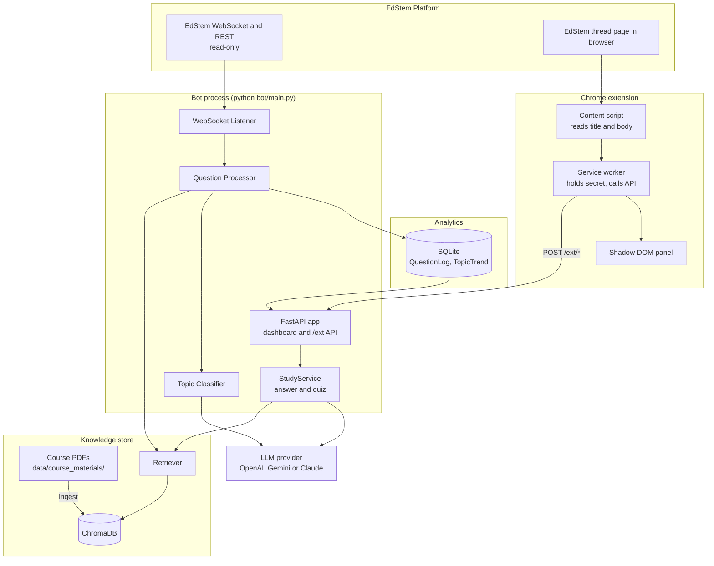

# EdStemBot

A read-only assistant for **EdStem** discussion boards, built for Computer Systems courses (operating systems, CPU architecture, memory, concurrency, networking, assembly). It has two parts that share one backend:

1. **Lecturer analytics dashboard.** Watches a course's EdStem threads in real time, matches each question against your lecture notes with retrieval-augmented generation (RAG), tags it with topics using an LLM, and shows trends so staff can see what students find hard.
2. **Student Chrome extension.** Adds a panel to EdStem thread pages with an AI answer preview and short multiple-choice quizzes grounded in the same course notes.

Nothing in this project posts to, edits, or otherwise changes anything on EdStem. All EdStem access is read-only.

---

## Contents

- [Features](#features)
- [Architecture](#architecture)
- [Prerequisites](#prerequisites)
- [Installation and configuration](#installation-and-configuration)
- [Usage](#usage)
- [Lecturer dashboard](#lecturer-dashboard)
- [Chrome extension](#chrome-extension)
- [Extension API reference](#extension-api-reference)
- [Extending the project](#extending-the-project)
- [Directory structure](#directory-structure)
- [Testing](#testing)
- [Troubleshooting](#troubleshooting)
- [Security and privacy](#security-and-privacy)
- [Known limitations](#known-limitations)

---

## Features

**EdStem integration**
- Listens to live course activity over EdStem's WebSocket stream (`thread.create` and `thread.update` events) with automatic reconnect.
- Backfills recent questions through the REST API on startup so the dashboard has history immediately.
- Read-only: the client exposes only GET-style operations (`get_course`, `list_threads`, `get_thread`, `get_thread_staff_qa`, `get_user`, `get_recent_questions`).

**RAG knowledge pipeline**
- Ingests lecture slides, notes and assignment PDFs with `pypdf`.
- Splits text into deterministic 500-character chunks with 100 characters of overlap, using stable chunk IDs so re-ingesting is idempotent.
- Embeds chunks with `sentence-transformers` (`all-MiniLM-L6-v2`) and stores them in a persistent **ChromaDB** collection using cosine distance.
- Retrieval returns the top 5 chunks and discards any with cosine distance above 0.6.
- Can also learn from staff: `scripts/learn_staff_answers.py` indexes staff-answered threads as additional knowledge.

**Multi-provider LLM layer**
- One interface (`LLMProvider.generate`), three implementations, selected by `LLM_PROVIDER`:

| Provider | Value | Default model |
|----------|-------|---------------|
| OpenAI | `openai` | `gpt-4o-mini` |
| Google Gemini | `gemini` | `gemini-1.5-flash` |
| Anthropic Claude | `claude` | `claude-haiku-4-5-20251001` |

**Topic analytics**
- Each question is tagged with 1 to 3 of 15 course topics: Memory Management, CPU Architecture, Operating Systems, File Systems, Networking, Concurrency, Assembly Language, Cache, Virtual Memory, Processes & Threads, I/O Systems, Security, Compilers & Linking, Data Representation, and Other.
- Each question is logged to SQLite with its topics and a retrieval confidence score (1 minus the best chunk's cosine distance).

**Dashboard**
- Overview KPIs, topic distribution, 7-day trends, an activity heatmap by day and hour, and a recent-activity feed.
- A "needs review" queue for low-confidence or unclassified questions.

**Chrome extension**
- Answer preview with topic tags, match confidence and sources.
- Multiple-choice quizzes with instant feedback, explanations and a score.

---

## Architecture



### Data flows

**New thread to dashboard**
1. The WebSocket listener receives a `thread.create` or `thread.update` event.
2. `QuestionProcessor.process` skips non-question threads, builds a query from the title and plain text, and calls `Retriever.retrieve`.
3. `TopicClassifier.classify` asks the LLM for topic tags, passing a hint about which sources matched. Unknown or failed results fall back to `Other`.
4. `AnalyticsTracker.log_question` stores the question, tags and confidence in SQLite. The dashboard reads from there.

**Extension answer preview**
1. The student opens a thread and expands the panel. Nothing is sent before this.
2. The content script reads the thread title and body from the page and asks the service worker to call `POST /ext/answer`.
3. `StudyService.answer` retrieves relevant chunks, classifies topics, and asks the LLM to answer from the retrieved context.
4. The panel renders the answer, topics, confidence and sources.

**Extension quiz**
1. `POST /ext/quiz` retrieves context for the thread. If nothing relevant is found it returns 404.
2. The LLM is asked for strict JSON containing multiple-choice questions grounded in that context.
3. The response is validated (exactly 4 string options, a valid answer index). Malformed output is retried once, then returns 502.

---

## Prerequisites

- Python 3.11 or 3.12 (conda recommended).
- An API key for at least one LLM provider (OpenAI, Google, or Anthropic).
- PDF course materials to index.
- Google Chrome (or another Chromium browser) for the extension.
- Optional: an EdStem API token and course ID. Without them the dashboard still runs in standalone mode, and the extension still works against your indexed PDFs.

---

## Installation and configuration

### 1. Create the environment

```bash
conda create -y -n edstembot python=3.11
conda activate edstembot
pip install -r requirements.txt
```

### 2. Configure `.env`

```bash
cp .env.example .env
```

All settings are read from environment variables or `.env` (see `config/settings.py`):

| Variable | Default | Purpose |
|----------|---------|---------|
| `ED_API_TOKEN` | empty | EdStem personal API token. Leave empty to run without the live listener. |
| `ED_COURSE_ID` | `0` | Course ID, taken from the EdStem course URL. |
| `ED_BASE_URL` | `https://us.edstem.org` | EdStem regional base URL. |
| `LLM_PROVIDER` | `openai` | One of `openai`, `gemini`, `claude`. |
| `OPENAI_API_KEY` | empty | Required when the provider is `openai`. |
| `GOOGLE_API_KEY` | empty | Required when the provider is `gemini`. |
| `ANTHROPIC_API_KEY` | empty | Required when the provider is `claude`. |
| `DATABASE_URL` | `sqlite+aiosqlite:///./edstembot.db` | SQLAlchemy async database URL. |
| `CHROMA_PERSIST_DIR` | `./chroma_db` | Where ChromaDB stores vectors. |
| `CHROMA_COLLECTION` | `course_materials` | ChromaDB collection name. |
| `EMBEDDING_MODEL` | `all-MiniLM-L6-v2` | sentence-transformers model. |
| `EXTENSION_SECRET` | empty | Shared secret for the Chrome extension API. The `/ext/*` endpoints return 503 until this is set. |
| `DASHBOARD_HOST` | `0.0.0.0` | Interface to bind. Use `127.0.0.1` to keep the server local. |
| `DASHBOARD_PORT` | `8000` | Port for the dashboard and extension API. |
| `LOG_LEVEL` | `INFO` | `DEBUG`, `INFO`, `WARNING` or `ERROR`. |

Example:

```env
ED_API_TOKEN=your_edstem_token
ED_COURSE_ID=12345
ED_BASE_URL=https://us.edstem.org

LLM_PROVIDER=claude
ANTHROPIC_API_KEY=your_key_here

EXTENSION_SECRET=a_long_random_string
```

> Never commit `.env`, and keep `.env.example` limited to placeholders. If a real token or key ever lands in a tracked file, revoke it and issue a new one.

---

## Usage

### Ingest course materials

Place PDFs in `data/course_materials/`, then:

```bash
python scripts/ingest_materials.py            # uses data/course_materials
python scripts/ingest_materials.py --dir path/to/pdfs
```

Re-running is safe: chunk IDs are derived from source, page and chunk index.

### Learn from staff answers (optional)

Indexes threads that staff have answered, giving the retriever high-value Q&A material:

```bash
python scripts/learn_staff_answers.py --limit 50
```

Requires `ED_API_TOKEN` and `ED_COURSE_ID`. Sources from this step appear in the extension as `EdStem Q&A #<thread id>`.

### Seed sample data (optional)

Fills the dashboard with realistic sample questions without needing EdStem credentials:

```bash
python scripts/seed_db.py
```

### Run

```bash
python bot/main.py
```

This starts the EdStem listener (if credentials are set) and the web server together. Open `http://localhost:8000` for the dashboard.

---

## Lecturer dashboard

| Page | Path | Content |
|------|------|---------|
| Overview | `/` | KPI cards, topic distribution, share chart, heatmap, recent activity |
| Topics | `/topics` | 7-day comparative trends and all topics ranked |
| Needs review | `/unclassified` | Low-confidence or unclassified questions |

JSON endpoints used by the charts:

| Endpoint | Returns |
|----------|---------|
| `GET /api/v1/kpis` | Headline metrics |
| `GET /api/v1/topics/distribution` | Question counts per topic |
| `GET /api/v1/topics/trends` | Daily counts per topic |
| `GET /api/v1/activity/heatmap` | Activity by day and hour |
| `GET /api/v1/questions/recent` | Most recent questions |
| `GET /api/v1/questions/unclassified` | Questions needing review |

---

## Chrome extension

A Manifest V3 extension in `extension/` that adds a collapsible panel to EdStem thread pages (`/courses/<id>/discussion/<id>`).

### Install

1. Set `EXTENSION_SECRET` in `.env` and start the bot with `python bot/main.py`.
2. Open `chrome://extensions`, enable **Developer mode**, click **Load unpacked**, and choose the `extension/` folder.
3. Open the extension's **Options** page. Enter the same secret and confirm the server URL (default `http://127.0.0.1:8000`). Only `http://127.0.0.1` and `http://localhost` are accepted.
4. Open an EdStem thread and click the "EdStemBot study helper" bar.

### What it does

- **Answer preview tab.** An answer drawn from your course notes, with topic tags, match confidence and sources. It is labelled as an AI preview, not an official answer.
- **Quiz me tab.** Three multiple-choice questions on the thread's topic. Each answer gives instant right or wrong feedback with an explanation, followed by a score and options to retry or get new questions.

### How it stays read-only

- The content script only reads text from the page and mounts its own panel inside a closed Shadow DOM. It never modifies EdStem's elements and never sends anything to EdStem.
- Requests go from the extension's service worker to your local server. The secret lives in extension storage and is never exposed to the page.
- No model call happens until the panel is first expanded. Responses are cached on the server, so reopening a thread does not spend more tokens.

### What leaves your machine

The thread title and body (up to 6000 characters of body from the page, truncated server-side to 8000) go to your local server, which forwards the question and retrieved course excerpts to the LLM provider you configured.

### Troubleshooting the extension

| Symptom | Likely cause and fix |
|---------|----------------------|
| Nothing appears | Reload the extension at `chrome://extensions`, then refresh the EdStem tab. Confirm you are on a thread URL, not the thread list. |
| Panel appears bottom-right instead of inline | The anchor selector did not match. This is harmless; adjust `anchor()` in `extension/selectors.js` to place it inline. |
| Empty or wrong question text | Adjust `title()` and `body()` in `extension/selectors.js`. |
| "Cannot reach the EdStemBot server" | The bot is not running, or the server URL in Options is wrong. |
| "Wrong secret" (401) | The secret in Options differs from `EXTENSION_SECRET` in `.env`. Restart the bot after editing `.env`. |
| "No course material matches this thread" (404) | Nothing relevant is indexed for that question. Ingest more PDFs. |
| "Server error (502)" | The LLM call failed or returned unusable quiz JSON. Check the bot's terminal for the traceback. |
| "Server error (503)" | `EXTENSION_SECRET` is not set on the server. |

Open DevTools and look for console lines prefixed `[EdStemBot]` to see whether the content script loaded and which thread it detected.

---

## Extension API reference

Base URL: `http://127.0.0.1:8000`. Every request needs the header `X-EdStemBot-Key: <EXTENSION_SECRET>` and a JSON body.

### Request body (both endpoints)

| Field | Type | Default | Notes |
|-------|------|---------|-------|
| `title` | string | required | Max 500 characters |
| `body` | string | `""` | Max 8000 characters |
| `n` | integer | `3` | Number of quiz questions, 1 to 5 (quiz only) |
| `refresh` | boolean | `false` | Skip the cache and regenerate |

### `POST /ext/answer`

```json
{
  "answer": "string, light markdown",
  "topics": ["Assembly Language"],
  "confidence": 0.91,
  "sources": ["ICS notes.pdf p.11"]
}
```

### `POST /ext/quiz`

```json
{
  "topic": "Virtual Memory",
  "questions": [
    {
      "q": "What does a TLB cache?",
      "options": ["A", "B", "C", "D"],
      "answer_index": 2,
      "explanation": "One or two sentences."
    }
  ]
}
```

### Status codes

| Code | Meaning |
|------|---------|
| 200 | Success |
| 401 | Missing or incorrect key |
| 404 | No relevant course material (quiz only) |
| 422 | Request body failed validation |
| 502 | LLM call failed or produced unusable output |
| 503 | `EXTENSION_SECRET` not configured, or the study service is not ready |

CORS allows only `chrome-extension://` origins and the `POST` method.

---

## Extending the project

**Add an LLM provider.** Subclass `LLMProvider` in `bot/llm/provider.py`, implement `async generate(system_prompt, user_prompt, **kwargs)`, honour `max_tokens` and `temperature` where the SDK supports them, and register it in `get_llm_provider` in `bot/llm/__init__.py` plus the `llm_provider` literal in `config/settings.py`.

**Change the topics.** Edit `COURSE_TOPICS` in `bot/llm/prompts.py`. The classifier prompt and validation both read from it. Keep `Other` as the fallback.

**Tune prompts.** `ANSWER_PROMPT`, `ANSWER_FORMAT`, `QUIZ_SYSTEM` and `QUIZ_USER` live in `bot/llm/prompts.py`.

**Tune retrieval.** `_MAX_DISTANCE` in `bot/rag/retriever.py` controls how strict relevance is; `n_results` controls how many chunks are returned. Chunk size and overlap are in `bot/rag/ingest.py`.

**Ideas for later**
- Streamed answers so text appears as it is generated.
- Quiz history and spaced repetition of missed questions, stored in extension storage.
- Clickable citations that open the source PDF page.
- A follow-up question box in the panel.
- A hosted backend so classmates can use the extension without running Python.

---

## Directory structure

```
EdStemBot/
├── config/
│   └── settings.py               # Centralised configuration (env and .env)
├── bot/
│   ├── main.py                   # Entry point: listener + web server
│   ├── processor.py              # New thread -> RAG -> classify -> SQLite
│   ├── study.py                  # Answer preview and quiz generation (extension)
│   ├── edstem/
│   │   ├── client.py             # Read-only REST client
│   │   ├── websocket.py          # Live listener with auto-reconnect
│   │   └── models.py             # Pydantic schemas
│   ├── rag/
│   │   ├── ingest.py             # PDF ingestion and chunking
│   │   ├── embeddings.py         # sentence-transformers wrapper
│   │   ├── vectorstore.py        # ChromaDB wrapper
│   │   └── retriever.py          # Query -> relevant chunks
│   ├── llm/
│   │   ├── provider.py           # Abstract provider interface
│   │   ├── openai_provider.py
│   │   ├── gemini_provider.py
│   │   ├── claude_provider.py
│   │   └── prompts.py            # Topics, answer and quiz prompts
│   └── analytics/
│       ├── tracker.py            # SQLite logging and aggregation
│       ├── classifier.py         # Topic classification
│       └── models.py             # ORM models (QuestionLog, TopicTrend)
├── dashboard/
│   ├── app.py                    # FastAPI app, CORS, router wiring
│   ├── routes/
│   │   ├── overview.py           # / and /unclassified
│   │   ├── topics.py             # /topics
│   │   ├── api.py                # /api/v1/* JSON endpoints
│   │   └── extension.py          # /ext/* endpoints for the extension
│   ├── templates/                # Jinja2 templates
│   └── static/                   # CSS and JavaScript
├── extension/
│   ├── manifest.json             # Manifest V3
│   ├── content.js                # Detects threads, mounts the panel
│   ├── selectors.js              # All EdStem DOM selectors in one place
│   ├── panel.js                  # Shadow DOM UI: answer and quiz
│   ├── background.js             # Service worker: calls the local API
│   └── options.html / options.js # Server URL and secret
├── data/
│   └── course_materials/         # Drop PDFs here
├── scripts/
│   ├── ingest_materials.py       # Index PDFs into ChromaDB
│   ├── learn_staff_answers.py    # Index staff-answered threads
│   └── seed_db.py                # Seed sample analytics data
└── tests/
    ├── test_analytics.py
    ├── test_edstem_client.py
    ├── test_rag.py
    └── test_extension_api.py
```

---

## Testing

```bash
pytest tests/ -v
```

The extension API tests use a stubbed LLM and retriever, so they need no network access or API keys. They cover quiz JSON parsing and validation, key authentication, fail-closed behaviour when no secret is configured, and both endpoints.

---

## Troubleshooting

**Dashboard shows no data.** Run `python scripts/seed_db.py` for sample data, or set `ED_API_TOKEN` and `ED_COURSE_ID` so the bot can backfill real threads.

**"VectorStore is empty" in the logs.** No PDFs have been ingested. Run `python scripts/ingest_materials.py`. Until then every question has zero confidence and lands in the review queue.

**Many questions in "needs review".** Either the notes do not cover the topic, or `_MAX_DISTANCE` is too strict for your material. Ingest more content or relax the threshold.

**Listener paused.** The bot logs a warning when `ED_API_TOKEN` or `ED_COURSE_ID` is missing. The dashboard and the extension still work.

**Port already in use.** Change `DASHBOARD_PORT` and update the server URL in the extension's Options.

**Changes to `.env` or Python code have no effect.** Restart the bot. The extension must be reloaded at `chrome://extensions` after changes to files in `extension/`.

---

## Security and privacy

- EdStem access is read-only. The bot never posts, edits or deletes anything.
- The extension API requires a shared secret, compared in constant time, and fails closed (503) when none is configured.
- CORS is restricted to `chrome-extension://` origins.
- By default the server binds to all interfaces (`DASHBOARD_HOST=0.0.0.0`). Set it to `127.0.0.1` if the dashboard should not be reachable from other machines.
- Thread text and retrieved course excerpts are sent to whichever LLM provider you configure. Check that this is acceptable for your course and institution.
- Keep tokens and API keys out of version control. Rotate any that have been exposed.

---

## Known limitations

- EdStem's page markup is not a public contract. The selectors in `extension/selectors.js` are best guesses and may need adjusting.
- The extension needs the bot running locally.
- The extension API response cache is in memory and clears on restart.
- Answers and quizzes are only as good as the ingested material, and can be wrong. They are previews, not official answers.
- Retrieval quality depends on PDF text extraction; scanned PDFs without a text layer will not index well.
